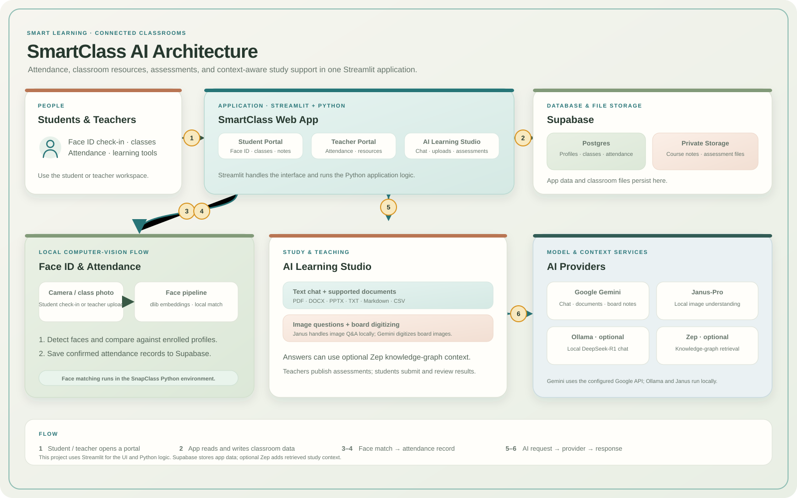

# SmartClass AI architecture

## Overview

SmartClass AI is a Streamlit application with Python application logic. Students and teachers use separate portals for face-based attendance, classes, course notes, and assessments. Supabase stores profiles, classroom records, and private course files.

The AI Learning Studio sends text, extracted document content, and uploaded images to the configured Gemini model. If Zep credentials are configured, relevant knowledge-graph snippets can be added as context to tutor answers.

## Main flows

1. A student or teacher opens the relevant Streamlit portal.
2. Face ID and classroom-image attendance use the local Python face pipeline; attendance records are stored in Supabase.
3. Teachers upload course materials and publish assessments. Students access course resources and submit assessment work through their dashboard.
4. The AI Learning Studio sends questions, supported document text, and images to Gemini. Optional Zep retrieval supplies relevant graph context.

The diagram reflects the current application. It does not include the earlier Anam avatar or FastAPI architecture.
